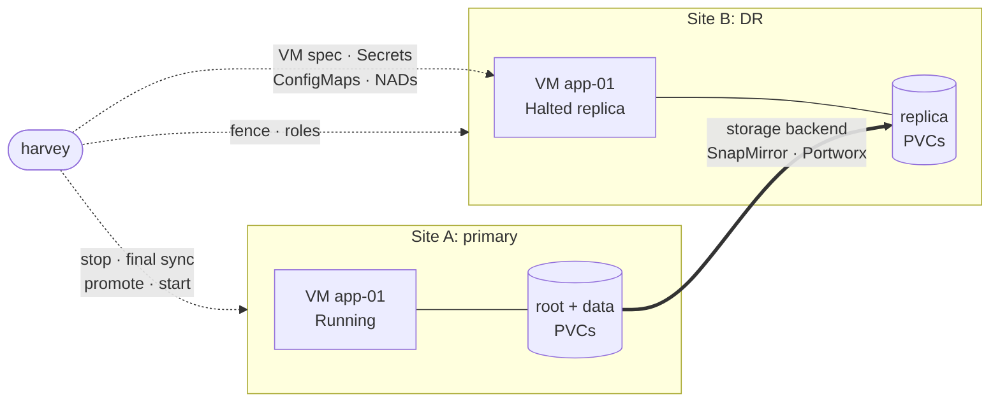
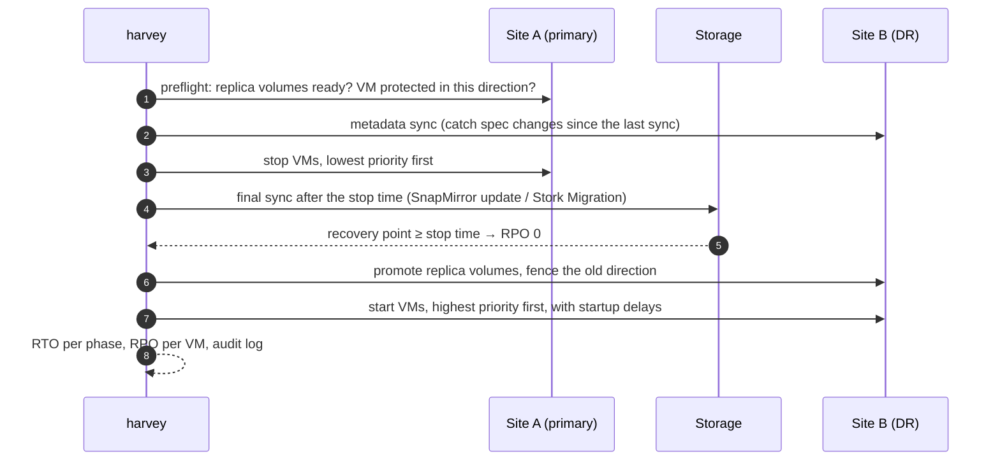

<p align="center">
  
</p>

<h1 align="center">Harvey</h1>

<p align="center">
  <b>Disaster recovery for virtual machines on SUSE Virtualization (Harvester) and KubeVirt.</b><br>
  Your storage moves the disks. Harvey moves everything else and runs the failover.
</p>

<p align="center">
  <a href="LICENSE"></a>
  <a href="https://www.python.org/"></a>
  <a href="https://github.com/abonillabeeche/harvey/releases"></a>
  
  
  
</p>

---

Storage arrays are good at copying blocks to another site. They don't know that those blocks belong to a
virtual machine that has a spec, a cloud-init Secret, a network attachment, a boot order and a team waiting
for it to come back. Harvey closes that gap. One command stops the VM, copies the last changes, makes the
replica disks writable and starts the VM on the other cluster. Then it tells you how long that took and how
much data, if any, you lost.

```console
$ harvey failover vm px-demo-1 -n harvey-px-demo -y
Preflight
  harvey-px-demo/px-demo-1: 2 volume(s) ready (Portworx async DR)
Metadata sync
Stop on on-prem
  ✓ harvey-px-demo/px-demo-1 stopped
Final sync
  ✓ harvey-px-demo/px-demo-1-root: 0 B in 75.7s
  ✓ harvey-px-demo/px-demo-1-data: 0 B in 75.7s
Promote on cloud
  ✓ harvey-px-demo/px-demo-1: 2 volume(s) read-write
Start on cloud
  ✓ harvey-px-demo/px-demo-1 Running
──── Failover Complete ────
╭──────────────────────────────┬───────────────╮
│ Metric                       │         Value │
├──────────────────────────────┼───────────────┤
│   stop                       │            6s │
│   final_sync                 │           75s │
│   promote                    │            0s │
│   start                      │            3s │
│ Total RTO                    │ 86s  (1m 26s) │
│ RPO harvey-px-demo/px-demo-1 │ 0s (lossless) │
╰──────────────────────────────┴───────────────╯
```

<sub>Real output from a lab run (cluster names shortened, summary rows trimmed): an on-premises cluster failing over to a
cluster on Vultr bare metal with Portworx.
Inside the guest, the only gap in a timestamp written every 5 seconds was the outage itself.</sub>

## Contents

- [How it works](#how-it-works)
- [Storage backends](#storage-backends)
- [The DR lifecycle, in commands](#the-dr-lifecycle-in-commands)
- [Priorities: who comes back first](#priorities-who-comes-back-first)
- [Measured in the lab](#measured-in-the-lab)
- [Safety rails](#safety-rails)
- [Installation](#installation) · [Configuration](#configuration) · [Command reference](#command-reference)
- [Recovery plans](#recovery-plans)
- [Write your own backend](#write-your-own-backend)
- [Known limitations](#known-limitations) · [Roadmap](#roadmap)

---

## How it works



- **Disks** are copied by your storage, through its Kubernetes integration. The replica volumes show up as
  normal, bound PVCs on the DR cluster.
- **Everything else** is copied by Harvey: the VirtualMachine (kept `Halted` on the DR side, same name, MACs
  and disk names), cloud-init and credential Secrets, ConfigMaps and NetworkAttachmentDefinitions.
- **State is kept in the clusters, not on your laptop.** Who is primary is a label on each copy of the VM,
  so any machine with the config can run Harvey, and two operators see the same truth.
- **No agents, no operators, no CRDs.** Harvey is a CLI that talks to the two Kubernetes APIs, either
  directly or through the Rancher proxy.

---

## Storage backends

Harvey picks the backend per VM from the CSI driver of its PVs, so one installation can protect NetApp,
Portworx and Longhorn VMs side by side.

| | **NetApp** (`netapp`) | **Portworx** (`portworx`) | **Longhorn** (`longhorn`) · *alpha* |
|---|---|---|---|
| Replication engine | ONTAP SnapMirror (async) | Portworx async DR through an S3 object store | Longhorn backups + DR (standby) volumes through an S3/NFS backup target |
| Driven through | Trident `TridentMirrorRelationship` per PVC | Stork `MigrationSchedule` per VM (volume-only) | Longhorn `RecurringJob`, `Backup` and standby `Volume` per PVC |
| CSI driver | `csi.trident.netapp.io` | `pxd.portworx.com` | `driver.longhorn.io` (V1 and V2 data engines) |
| Schedule | ONTAP job schedule (`5min` minimum supported) | Stork interval policy (15 min recommended) | recurring backup cron (5 min default) |
| Planned failover | final SnapMirror update → **RPO 0** | final one-off Migration → **RPO 0** | final backup + incremental restore → **RPO 0** |
| Unplanned recovery point | newest replicated snapshot, per volume | last migration, the same point for all disks of the VM | last restored backup, per volume |
| Promote | TMR → `promoted`, verified and broken via ONTAP REST if needed | fence: Stork `applicationActivated` on the DR copy | activate the DR volume, then create PV + PVC |
| Reprotect | reverse resync (incremental) | reverse migration (full copy, then incremental) | DR volume of the new primary (full restore, then incremental) |
| Tested with | Trident 26.06, ONTAP 9.16.1 | Portworx 3.7.1, Stork 26.4.2 | Longhorn 1.12.1 ↔ 1.13.0, **V1**; V2 untested |
| Docs | [docs/netapp.md](docs/netapp.md) | [docs/portworx.md](docs/portworx.md) | [docs/longhorn.md](docs/longhorn.md) |

Not seeing your storage? A backend is one Python class. See [Write your own backend](#write-your-own-backend).

---

## The DR lifecycle, in commands

### 1. Protect: start replicating

```console
$ harvey protect px-demo-1 -n harvey-px-demo
  waiting for the baseline migration on-prem → cloud ...
  storage backend: portworx (Portworx async DR)
  on-prem: labelled 2 PVC(s)+PV(s) harvey.io/vm=px-demo-1
  on-prem: migrationschedule harvey-px-demo/harvey-px-demo-1 created (pair harvey-to-cloud, every 15 min)
  cloud: pvc/px-demo-1-root migrated (732700672 B)
  cloud: pvc/px-demo-1-data migrated (0 B)
  cloud: secret/px-demo-1-cloudinit created
  cloud: vm/px-demo-1 created (Halted)
  ✓ harvey-px-demo/px-demo-1 protected
```

### 2. Watch: know your RPO before you need it

```console
$ harvey replication status
╭──────────────────────────┬────────────────┬──────────┬────────────────┬─────────────┬─────────┬───────┬────────────────╮
│ VM / direction / state   │ Volume         │ Backend  │ State pri→rep  │ Replication │ Healthy │ Lag   │ Recovery point │
├──────────────────────────┼────────────────┼──────────┼────────────────┼─────────────┼─────────┼───────┼────────────────┤
│ harvey-px-demo/px-demo-1 │ px-demo-1-root │ portworx │ active→standby │ Successful  │ yes     │ 2m21s │ 06:29:01       │
│ on-prem → cloud          │ px-demo-1-data │          │ active→standby │ Successful  │ yes     │ 2m21s │ 06:29:01       │
│ Running / Stopped        │                │          │                │             │         │       │                │
│ harvey-px-demo/px-demo-2 │ px-demo-2-root │ portworx │ active→standby │ Successful  │ yes     │ 6m40s │ 06:24:43       │
│ cloud → on-prem          │ px-demo-2-data │          │ active→standby │ Successful  │ yes     │ 6m40s │ 06:24:43       │
╰──────────────────────────┴────────────────┴──────────┴────────────────┴─────────────┴─────────┴───────┴────────────────╯
Worst lag: 6m40s  (lag = age of the newest replicated recovery point = worst-case data loss if the primary site fails now)

$ harvey health-check on-prem cloud
  ✓ 'on-prem' reachable — 10 VMs found.
  ✓ 'cloud' reachable — 9 VMs found.
  ✓ No split-brain conditions detected.
    ✓ harvey-px-demo/px-demo-1 on-prem → cloud: 2 volume(s), worst lag 2m23s
    ✓ harvey-px-demo/px-demo-2 cloud → on-prem: 2 volume(s), worst lag 6m41s
│ ✓ DR health check PASSED — environment ready for failover. │
```

Yes, that's two VMs replicating in **opposite directions** between the same two clusters. Each VM has its own
primary.

### 3. Fail over: stop, re-sync, start



Here it is with the NetApp backend (three disks, recorded in the lab, RTO 72 s):


### 4. When the primary site is gone: unplanned failover

```console
$ harvey failover vm px-demo-2 -n harvey-px-demo --unplanned -y
Preflight
  harvey-px-demo/px-demo-2: 2 volume(s) ready (Portworx async DR)
Promote on cloud
  on-prem unreachable: its schedule harvey-px-demo/harvey-px-demo-2 is still enabled there; with autoSuspend it
  suspends itself when it sees cloud active. Run harvey reprotect once on-prem is back.
  ✓ harvey-px-demo/px-demo-2: 2 volume(s) read-write
Start on cloud
  ✓ harvey-px-demo/px-demo-2 Running
│ Total RTO                    │ 3s  (0m 3s) │
```

Harvey reports the RPO as a safe upper bound computed from the replica's own metadata. It doesn't need the dead
site to answer.

### 5. Come home: reprotect and failback

```console
$ harvey reprotect px-demo-2 -n harvey-px-demo -y
  on-prem: stale primary copy (unplanned failover) demoted to replica
  on-prem: migrationschedule harvey-px-demo/harvey-px-demo-2 deleted (old direction)
  cloud: migrationschedule harvey-px-demo/harvey-px-demo-2 created (pair harvey-to-onprem)
  on-prem: pvc/px-demo-2-root overwritten from cloud (737685504 B)
  ✓ harvey-px-demo/px-demo-2 replicating cloud → on-prem

$ harvey failback px-demo-1 -n harvey-px-demo -y      # planned failover back + reprotect, one command
  ...
│ Total RTO                    │ 119s  (1m 59s) │
│ RPO harvey-px-demo/px-demo-1 │  0s (lossless) │
  on-prem: migrationschedule harvey-px-demo/harvey-px-demo-1 created (pair harvey-to-cloud)
  cloud: vm/px-demo-1 created (Halted)
```

After the round trip, the guest's timestamp log ran on-prem → cloud → on-prem with exactly two gaps, one per
planned outage, and no lost writes.

---

## Priorities: who comes back first

A real outage doesn't fail over one VM. It fails over a database, the application servers that need it and the
web tier in front of them, in that order. Give each VM a priority with two labels, and Harvey orders every
failover, failback and plan run by them:

```bash
kubectl -n production label vm db-01  failover-priority=100 failover-startup-time=60
kubectl -n production label vm app-01 failover-priority=50  failover-startup-time=30
kubectl -n production label vm app-02 failover-priority=50  failover-startup-time=30
kubectl -n production label vm web-01 failover-priority=10
```

- **Higher priority = stopped last, started first.** The database keeps serving until everything that writes to
  it is down, and it's running before anything that needs it starts.
- **`failover-startup-time`** is how many seconds Harvey waits after starting that VM before it starts the next
  one. That gives the database time to accept connections.
- VMs without the label get priority 0. VMs with the same priority go in name order (namespace, then VM name);
  in a recovery plan they go in the order the plan lists them.

Preview the order with `--dry-run`. Nothing changes, and you can save the result as a recovery plan:

```console
$ harvey failover namespace production --dry-run
              Failover Plan: on-prem → cloud
╭────────┬─────────┬────────────┬─────────┬──────────┬───────────────╮
│ Stop # │ Start # │ Namespace  │ VM Name │ Priority │ Startup Delay │
├────────┼─────────┼────────────┼─────────┼──────────┼───────────────┤
│      1 │       4 │ production │ web-01  │       10 │             — │
│      2 │       2 │ production │ app-01  │       50 │           30s │
│      3 │       3 │ production │ app-02  │       50 │           30s │
│      4 │       1 │ production │ db-01   │      100 │           60s │
╰────────┴─────────┴────────────┴─────────┴──────────┴───────────────╯

DRY RUN — no changes will be made.
  Phases: metadata sync → stop (lowest priority first) → final sync → promote replica volumes → start (highest priority first)
  Would fail over production/web-01  (priority 10)
  Would fail over production/app-01  (priority 50)
  Would fail over production/app-02  (priority 50)
  Would fail over production/db-01  (priority 100)
──── Dry run complete ────

Save this as a recovery plan? [y/n] (n): y
Plan name: production-dr
✓ Plan saved to ~/.config/harvey/plans/production-dr.yaml
```

<sub>Example VMs. The table layout is the one `harvey failover --dry-run` prints.</sub>

The saved plan has one protection group per priority. Edit it to add hooks or change the order without
relabeling VMs. In a plan, the group's `priority` and `startup_delay` override the labels. See
[Recovery plans](#recovery-plans).

---

## Measured in the lab

All output in this README is from these runs, with cluster names shortened. Small Leap 16 VMs (5 GiB root disk cloned from an image plus a 1 GiB data disk). Inside each guest, a service
writes a UTC timestamp to every disk every 5 seconds, so any lost write shows up as a gap.

| Scenario | NetApp SnapMirror<br/><sub>two ONTAP 9.16.1 simulators</sub> | Portworx async DR<br/><sub>on-prem ↔ Vultr bare metal, over the internet</sub> | Longhorn DR volumes (V1)<br/><sub>two on-prem clusters, local Ceph RGW</sub> |
|---|---|---|---|
| Planned failover | RTO **72–101 s** (3 runs), RPO **0** | RTO **86 s**, RPO **0** | RTO **93 s**, RPO **0** |
| Failback (planned failover back + reprotect) | RTO **75–95 s** (4 runs), RPO **0** | RTO **119 s**, RPO **0** | RTO **93 s**, RPO **0** |
| Unplanned failover | loss 7 s (data disks) to 62 s (root); disks of one VM can differ | **3 s** to Running; all disks from one point in time | **31 s** to Running; reported ≤ 180 s, real loss 151–156 s |
| Old site comes back after an unplanned failover | Harvey refuses to sync over the newer primary | Stork suspends the old schedule itself (fence) | activated DR volumes stop restoring; reprotect demotes the stale primary |

Results depend on link speed, change rate and array load. Measure your own: `harvey audit` keeps RTO and RPO
for every run.

---

## Safety rails

DR tools fail in the worst possible moment, so Harvey checks before it acts:

- **Split-brain refusal.** An unplanned failover refuses to start a VM that is still running on a reachable
  source, unless you pass `--force`.
- **No silent data loss.** A planned failover promotes a VM only if its final sync produced a recovery point
  newer than the moment the VM stopped. If the sync fails, that VM stays stopped and the others continue.
- **Fencing.** After a failover the old direction can't overwrite the promoted disks. NetApp breaks the
  relationship. Portworx sets Stork's "application active here" flag, so a returning site suspends its own
  schedule.
- **Stale primaries.** After an unplanned failover both sites claim the VM. Harvey stamps
  `harvey.io/primary-since`, so the newer primary wins, the stale copy is flagged in `status` and `health-check`,
  and `reprotect` demotes it, but only while it's stopped.
- **Trust, but verify.** On NetApp, Harvey checks the ONTAP volume type after a promote and breaks the mirror
  itself if Trident left it DP. On Portworx, the RPO comes from the migration's trigger time, not the time
  Stork applied the PVC.
- **Audit everything.** Every operation lands in a JSONL audit log with timings, RTO and RPO.

---

## Installation

```bash
# uv manages CLI tools in isolated environments and bundles its own Python
brew install uv                      # or: curl -LsSf https://astral.sh/uv/install.sh | sh
uv tool install git+https://github.com/abonillabeeche/harvey.git
harvey --help
```

Upgrade with `uv tool upgrade harvey`. Prefer pipx? Use
`pipx install git+https://github.com/abonillabeeche/harvey.git`. Wheels for each release are on the
[Releases page](https://github.com/abonillabeeche/harvey/releases) (`uv tool install harvey-X.Y.Z-py3-none-any.whl`).
From source: `git clone … && cd harvey && pip install .`

### Requirements

- Two SUSE Virtualization (Harvester) or KubeVirt clusters, reachable from where you run Harvey through a
  kubeconfig (token or client certificate) or the Rancher proxy.
- **NetApp:** Trident ≥ 22.10 on ONTAP, the two ONTAP clusters cluster-peered and the SVMs vserver-peered for
  SnapMirror (unique SVM names), an ONTAP job schedule on both sides. Harvey discovers the ONTAP credentials
  from Trident's backend config (an SVM-scoped `vsadmin` is enough). Details in [docs/netapp.md](docs/netapp.md).
- **Portworx:** Portworx Enterprise with PX-DR and Stork on both clusters (same version), an S3 bucket both
  clusters can reach, and one Stork ClusterPair per direction. Setup is in
  [docs/portworx.md](docs/portworx.md).
- **Longhorn (alpha):** Longhorn 1.8 or later on both clusters (1.12+ for V2), the same Longhorn `BackupTarget`
  on both clusters, and VM disks that aren't tied to a cluster-local backing image (use CDI images, see
  [docs/longhorn.md](docs/longhorn.md)).

---

## Configuration

```bash
harvey config init        # writes ~/.config/harvey/config.yaml  (or $HARVEY_CONFIG_DIR/config.yaml)
```

```yaml
rancher_url: "https://rancher.example.com"     # only for clusters reached through the Rancher proxy
api_token:   "token-abcde:..."

clusters:
  on-prem:
    kubeconfig: ~/.kube/on-prem.yaml           # token or client cert; context: optional
  cloud:
    rancher_cluster_id: c-m-xxxxxxxx           # ... or through Rancher
    # ontap: {host: 192.0.2.10, username: vsadmin, password_env: DR_ONTAP_PW}   # NetApp override (optional)

defaults: {source: on-prem, destination: cloud}

replication:
  # backend: netapp | portworx                 # optional; default = picked per VM from the CSI driver
  max_lag_seconds: 1200                        # health-check threshold
  storage_class_map: {}                        # source SC -> DR SC when the names differ (NetApp)
  timeouts: {stop: 300, start: 600, tmr: 300, transfer: 1800, stall: 120}
  netapp:
    policy: MirrorAllSnapshots                 # async SnapMirror policy
    schedule: 5min                             # ONTAP schedule = your unplanned RPO
  portworx:
    interval_minutes: 15                       # Stork SchedulePolicy harvey-<N>min
    pairs:                                     # Stork ClusterPair per direction ("name" or "namespace/name")
      on-prem->cloud: harvey-to-cloud
      cloud->on-prem: harvey-to-onprem
  longhorn:                                    # alpha
    backup_target: harvey                      # Longhorn BackupTarget with the same name + URL on both clusters
    interval_minutes: 5                        # recurring backup cron
    retain: 12
    # replicas: 2                              # DR volume replicas (default: same as the source)
```

Configs from 0.2 (top-level `replication.policy` / `schedule`) keep working.

---

## Command reference

| Command | What it does |
|---|---|
| `harvey protect -n NS VM… [--wait]` | Start replicating a VM's disks and copy its metadata; the replica VM is created `Halted` |
| `harvey unprotect -n NS VM… [--delete-replica]` | Stop replicating; optionally delete the replica VM, its volumes and copied Secrets |
| `harvey replication status [-n NS]` | Per volume: backend, relationship state on both sides, health, **lag**, recovery point |
| `harvey sync [-n NS] [VM…] [--watch 300]` | Re-copy the VM spec, Secrets, ConfigMaps and NADs from each primary to its replica |
| `harvey failover vm VM… -n NS` | Planned failover: sync, stop, final sync, promote, start (RPO 0) |
| `harvey failover namespace NS` · `failover all` | The same for every running protected VM in a namespace or cluster |
| `harvey failover … --unplanned [--force]` | Source site down: promote and start the last replicated data, report the RPO |
| `harvey reprotect -n NS VM… [--wait]` | After a failover: replicate back, overwriting the old copy |
| `harvey failback -n NS VM…` | Planned failover back plus reprotect, in one command |
| `harvey health-check A B` | Reachability, split-brain, replication health and lag threshold, plan coverage |
| `harvey status A B` | VM state side by side |
| `harvey audit [--limit N]` | The JSONL audit log, including RTO and RPO per failover |
| `harvey plan new / edit / list / show / run` | Recovery plans (below) |

Every failover command takes `--dry-run` and `--yes`. Ordering comes from labels on the VirtualMachine:

```yaml
metadata:
  labels:
    failover-priority:     "100"   # higher = stopped LAST, started FIRST
    failover-startup-time: "60"    # seconds to wait after starting this VM
```

---

## Recovery plans

A plan is a YAML runbook: groups of VMs with priorities and startup delays, plus shell hooks for the things
around the VMs (DNS, load balancers, a message to the on-call channel).

```yaml
name: production-dr
source: on-prem
destination: cloud
protection_groups:
  - name: database-tier
    priority: 100          # stopped last, started first
    startup_delay: 60
    vms: [{namespace: production, name: db-primary}]
  - name: app-tier
    priority: 50
    vms: [{namespace: production, name: app-server-1}]
hooks:
  pre_failover:  [{name: "page on-call", command: "curl -sf -X POST -d 'DR starting' https://hooks.example/...", on_failure: abort}]
  pre_start:     [{name: "drain LB",     command: "./scripts/lb-drain.sh --site on-prem"}]
  post_failover: [{name: "move DNS",     command: "./scripts/update-dns.sh --target cloud", timeout: 60}]
```

```bash
harvey plan run production-dr --dry-run       # show the order, change nothing
harvey plan run production-dr                 # planned failover with hooks
harvey plan run production-dr --unplanned     # site down
harvey plan run production-dr --reverse       # failback, after reprotect
harvey plan run production-dr --test          # boot test in shadow namespaces
```

Hooks get `HARVEY_SOURCE` and `HARVEY_DESTINATION` in their environment.

---

## Write your own backend

Harvey's orchestrator doesn't know which storage it drives. A backend implements a handful of idempotent
methods and registers the CSI drivers it handles:

```python
from harvey.backends import register
from harvey.backends.base import StorageBackend

@register
class MyArrayBackend(StorageBackend):
    name = "myarray"                       # config section: replication.myarray
    drivers = ("csi.myarray.example.com",) # VMs on these PVs use this backend
    engine = "MyArray Replicate"
    drop_annotation_prefixes = ("myarray.example.com/",)

    def protect(self, src, dst, ns, vm, claims, wait_init): ...      # start replication, create replica PVCs
    def preflight(self, src, dst, ns, vm, claims, src_up): ...       # is dst a promotable replica?
    def final_sync(self, src, dst, ns, vm, claims, not_before): ...  # planned failover: last changes, RPO 0
    def recovery_point_age(self, src, dst, ns, vm, claims, src_up): ...  # unplanned: how old is the data?
    def promote(self, src, dst, ns, vm, claims, src_up, unplanned): ...  # make dst writable, fence src
    def reprotect(self, new_src, new_dst, ns, vm, claims, wait_init): ...
    def unprotect(self, primary, replica, ns, vm, claims): ...
    def volume_status(self, primary, replica, ns, vm, claims): ...   # rows for `replication status`
```

The orchestrator (`harvey/replication.py`) handles the rest: metadata sync, roles, stop and start ordering,
hooks, split-brain checks, RTO/RPO accounting and the audit log. `tests/test_backends.py` shows how to test a
backend against an in-memory fake Kubernetes API.

---

## Known limitations

- **Asynchronous replication.** Both backends replicate asynchronously, so an unplanned failover loses up to one
  replication interval. Planned failovers are lossless.
- **NetApp: per-volume consistency.** Each disk is its own SnapMirror relationship, so after an *unplanned*
  failover the disks of one VM can come from different points in time. Trident doesn't expose ONTAP consistency
  groups. Keep the array's concurrent-transfer limit in mind at scale.
- **NetApp: Trident promote quirk (26.06 / ONTAP 9.16.1).** A TMR can say `promoted` while the volume is still
  DP. Harvey verifies the volume and breaks the mirror itself. Details in [docs/netapp.md](docs/netapp.md).
- **Portworx: reprotect is a full copy.** Portworx restores into a new volume on the old primary. Stork's
  KubeVirt failback cleanup also deletes the stopped replica VM, which Harvey recreates. Details in
  [docs/portworx.md](docs/portworx.md).
- **Longhorn is alpha and backup based.** Every recovery point is a backup, reprotect is a full restore, and a V1
  disk built on a Harvester backing image only restores where a backing image with the same name exists (Harvester
  names them after the image UID). V2 is untested. Details in [docs/longhorn.md](docs/longhorn.md).
- **`--test` mode** boots copies of the VM spec in shadow namespaces but does not clone the replica volumes yet.

---

## Roadmap

- [ ] **TODO: Recovery groups.** Make "an application" a first-class unit: a named set of VMs (for example the
  label `harvey.io/recovery-group=billing`) that you protect, sync, fail over, reprotect and fail back with one
  command. The group would report health and lag as a whole, and recovery plans would reference groups instead
  of listing VMs. Where the storage allows it, all of a group's disks would share one recovery point: Portworx
  can migrate the whole group in one Stork migration. Trident doesn't expose ONTAP consistency groups yet, so on
  NetApp a group stays crash-consistent per volume until it does.
- [ ] `plan run --test` that boots clones of the replica volumes (FlexClone on NetApp, snapshots on Portworx)
  in an isolated namespace, not just the VM spec.
- [ ] `harvey bench`: repeatable failover/failback measurements (RTO per phase, RPO from an in-guest marker,
  database consistency checks) written to CSV.
- [ ] Longhorn V2 data engine: lab test (needs two clusters with V2 disks), then drop the alpha label.
- [ ] Longhorn V1: restore a missing backing image on the DR cluster automatically, under its original name,
  from its backing-image backup.
- [ ] Per-site adjustments at promotion (node affinity, NAD or StorageClass changes) for DR sites that aren't
  identical.

---

## Releasing

Update `version` in `pyproject.toml` and `src/harvey/__init__.py`, then tag and push. GitHub Actions builds the
wheel and creates the release:

```bash
git tag v0.3.0 && git push origin v0.3.0
```

## Version history

| Version | Highlights |
|---|---|
| 0.3 | Pluggable storage backends; **Portworx async DR**; **Longhorn DR volumes (alpha, V1 lab-tested)** (Stork volume-only migrations, fencing, RPO from the migration trigger time); stale-primary handling after unplanned failovers; health-check scoped to the cluster pair |
| 0.2 | Storage-aware DR with NetApp SnapMirror via Trident: protect, replication status with lag, metadata sync, planned (lossless) and unplanned failover, reprotect, failback; kubeconfig or Rancher access; ONTAP credential discovery |
| 0.1 | Stop/start failover, priorities and startup delays, recovery plans with hooks, DR test mode, RTO tracking, audit log, health-check |

## Contributing

Issues and pull requests are welcome. For a new storage backend or another significant change, please open an
issue first.

## License

Apache License 2.0. See [LICENSE](LICENSE).

<p align="center"><sub>Harvey the beaver builds dams for a living. He knows a thing or two about what happens when one breaks.</sub></p>
